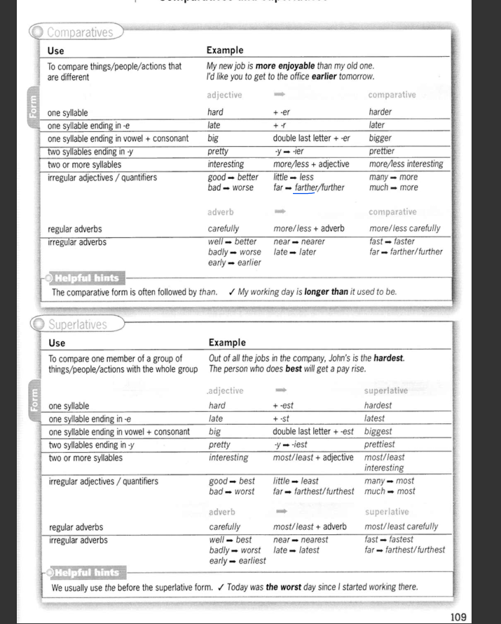

# GRAMMAR UNIT

- Word
    - Word class

|Word class	|Subtopics|
|:--|:--|
|Noun |	Common/proper, count/uncount, concrete/abstract, number, case|
|Verb	|Lexical/auxiliary, transitive/intransitive, regular/irregular, stative/dynamic|
|Adjective	|Attributive/predicative, gradable/non-gradable, comparative/superlative|
|Adverb |	Manner, time, place, frequency, degree, stance|
|Determiner	|Articles, demonstratives, possessives, quantifiers, distributives|
|Pronoun	|Personal, reflexive, reciprocal, demonstrative,| interrogative, relative, indefinite|
|Preposition|	Simple/complex, prepositional complements, spatial/temporal/abstract meanings|
|Conjunction|	Coordinators, subordinators|
|Auxiliary|	Primary auxiliaries, modal auxiliaries|
|Particle	|Phrasal verb particles, infinitival to, other particle constructions|

<!-- Word classes

Lexical words vs. grammatical words

Simple, complex, and compound words

Inflected forms

Lexemes and word forms -->

- Phrase
    - Word phrase

| Classification | Types |
| :-- | :-- |
|By finiteness|	Finite, non-finite, verbless|
|By syntactic status|	Main, subordinate|
|By function|	Declarative, interrogative, imperative, exclamative|
|By subordinate clause function	Content, relative, comparative, adverbial|
|By structure|	Intransitive, transitive, ditransitive, complex-transitive, copular|

- Clause

    - Function:
        - Declarative, interrogative, imperative, exclamative

    - Finite clause

        - Independent clause / Main clause

        - Dependent clause / subordinate clause
        
            - Content clause
                - Noun clause
            - Relative clause
            - Adverbial clause
            - Comparative clause [?]

        - Non-finite clause 
        
        <!-- 
        (https://dictionary.cambridge.org/grammar/british-grammar/clauses-finite-and-non-finite) 
        
        -->

            - To-infinitive clause
            - Bare infinitive clause
            - Present participle / gerund clause
            - Past participle clause

- Sentence

# VERB GRAMMAR

__TENSE__

- Time

- Aspect

__VOICE__
- Active voice
- Passive voice
- Get passive
- Causative constructions

__MOOD__
- Indicative
- Imperative
- Subjunctive

# MORPHOLOGY

<!-- Morphemes: free and bound

Roots, stems, bases

Prefixes and suffixes

Inflection vs. derivation

Allomorphs

Irregular inflection -->

- Inflectional morphology
    - Plural -s
    - Past -ed
    - Progressive -ong
    - Comparative -er

- Derivational morphology
    - Prefixes
    - Suffixes

- Word formation
    - Compounding
    - Conversion
    - Blending
    - Clipping
    - Abbreviation

# Mixcellaneous

- article
- question tags
- indirect questions
- so - such, too - enough
- reported speech

# Short

- find someone/something adj
- used to
- be used to
- as long as, so long as,provided that
- causuative:
    - have someone to
    - make someone/something adj/V
    