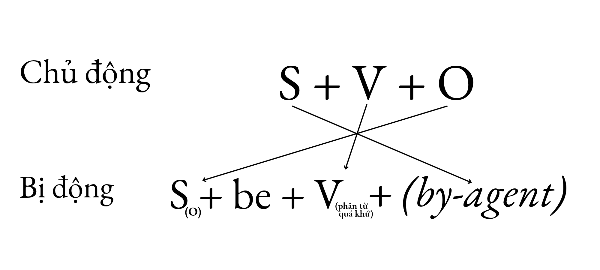

<!-- # I. GIỚI THIỆU VỀ THỂ (VOICES)

# II. BỊ ĐỘNG -->

## 1. Chức năng của thể bị động

_Thể bị động_ được sử dụng để tập trung diễn tả hành động khi tác nhân gây ra hành động không được biết đến hoặc không quan trọng. 

Trong một câu chủ động, chủ ngữ trực tiếp thực hiện hành động.

- Someone has stolen my wallet.

- Leonardo drew the Mona Lisa.

Nhưng trong một mệnh đề _bị động_, chủ thể được nhấn mạnh vào việc bị tác động bởi hành động.

- My wallet has been stolen.

- The Mona Lisa was drawn by Leonardo.

_Thể bị động_ thường mang tính trang trọng và lịch sự hơn _thể chủ động_, nhưng bạn cần sử dụng cấu trúc này một cách hợp lý và tránh lạm dụng dẫn đến việc câu văn trở nên thô và máy móc.

## 2. Cấu trúc bị động

Cấu trúc của _bị động_ có dạng chung gồm một chủ ngữ chính, trợ động từ _be_ được chia theo thì, và động từ chính được chia ở dạng _phân từ quá khứ_.

__S + be + V(phân từ quá khứ)__

Trong đó:

- __S__ là chủ ngữ chính
- Trợ động từ **be** được chia theo thì
- **V(phân từ quá khứ)** là động từ được chia ở dạng _phân từ quá khứ_

 _Nội động từ (intransitive verbs)_ không thể được sử dụng làm động từ chính ở dạng bị động vì chúng không có tân ngữ (lý do cụ thể sẽ được giải thích ở phần sau).

- English is spoken all over the world.

- This mansion was built in the 18th century.

- The theft is being chased.

- My phone was broken.

- The fire had been put out before it could spread to he adjacent buildings.

- This package will be sent to you soon.

- Systems of linear equations can be solved with Gaussian elimination.

- The car hasn't been fixed yet.

- Where is the party held?

### Các thành phần bổ trợ cho cấu trúc bị động

### Cụm tác nhân (by-agent)

_Cụm tác nhân_ là một cụm giới từ cung cấp thông tin về tác nhân của hành động trong một mệnh đề bị động. Cụm này có cấu trúc như sau:

__by + *[tác nhân (danh từ, đại từ làm tân ngữ)]*__

Vị trí của _cụm tác nhân_ có thể đứng đằng sau động từ bị động hoặc sau _trạng ngữ_ đứng sau động từ bị động. Cách lựa chọn vị trí cần đảm bảo cho câu không bị mơ mồ.

- Our parents held this event and everything was organized <u>by them</u>.

- _Les Misérables_ was written <u>by Victor Hugo</u> between 1845 and 1862.

- The theft has been arrested yesterday <u>by the police</u>.

### Cụm phương tiện (instrumental phrase)

_Cụm phương tiện_ là một cụm giới từ cung cấp thông tin về dụng cụ, công cụ được sử dụng gây ra hành động. Cụm này có cấu trúc như sau:

__with + *[công cụ]*__

- The window was broken with a hammer.

- This video was made with an editing software.

- The cake is cut with a knife.

<!-- position of by-agent in a clause -->

<!-- ### 2.1. Thể bị động đơn giản

### 2.2. Thể bị động tiếp diễn

### 2.3. Thể bị động hoàn thành

### 2.4. Bị động với động từ tình thái -->

## 3. Cách biến đổi mệnh đề chủ động sang mệnh đề bị động

Khi chuyển một câu chủ động sang bị động, chúng ta trước tiên đưa tân ngữ của động từ chính lên làm chủ ngữ, giữ các trợ động từ gốc và thêm trợ động từ _be_ được biến đổi theo thì hiện tại của câu, cuối cùng là biến đổi động từ chính thành dạng _phân từ quá khứ_. Ta có thể biến đổi chủ ngữ tác nhân ở câu gốc  thành _cụm tác nhân_, nhưng nó thường bị lược bỏ nếu tác nhân đó là một trong các thành phần sau đây:

- tác nhân không quan trọng, đã được đề cập hoặc ngầm hiểu
- tác nhân là đại từ: _I, you, he, she, it, we, they_.
- tác nhân là các đại từ bất định: everyone, someone, anyone, no one, everything, etc.

Lưu ý rằng nếu tân ngữ được đưa lên làm chủ ngữ là một _đại từ tân ngữ_ thì ta phải sử dụng một _đại từ chủ ngữ_ tương ứng.

- **He** hit me all of a sudden. 
    - &rarr; I was hit *(by **him**)* all of a sudden.

- The England annexed Wales between 1535 and 1542.
    - &rarr; Wales was annexed by the England between 1535 and 1542.

- You can borrow books from the library.
    - &rarr; Books can be borrowed from the library.

- They are painting the wall at the moment.
    - &rarr; The wall are being painted at the moment.

Nếu động từ chính có cả _tân ngữ trực tiếp_ và _tân ngữ gián tiếp_, ta có thể chuyển một trong hai tân ngữ lên làm chủ ngữ và đặt tân ngữ còn lại đứng sau động từ. 

Lưu ý rằng ta đôi khi cần có giới từ phù hợp để nối động từ với tân ngữ còn lại đứng sau nếu đó là một tân ngữ gián tiếp.

- He gave me this book.
    - &rarr; I was given this book.
    - &rarr; This book was given to me.

- Our teacher asked us a difficult question.
    - &rarr; We were asked a difficult question by our teacher.
    - &rarr; A difficult question was asked **of** us by our teacher.

- The company paid each customer $500 as compensation.
    - &rarr; Each customer was paid $500 as compensation by the company.
    - &rarr; $500 was paid **to** each customer as compensation by the company.

- The organizers will give all the funds raised to orphans.
    - &rarr; All the funds raised will be given to orphans by the organizers.
    - &rarr; Orphans will be given all the funds raised by the organizers

- We do not sell users' data to third parties.
     -  &rarr; Users' data is not sold to third parties.

Đôi khi có nhiều câu có thể được chuyển sang dạng bị động theo nhiều cách diễn đạt khác nhau. Việc lựa chọn cách thức chuyển phụ thuộc vào mục đích của người viết.

- He used glass as the material for his art.
    - &rarr; Glass is used as the material for his art.
    - &rarr; His art is made with glass as the material.

<!-- This example contains a analogue in which it can be intepreted as the action of giving is done by the organizers or the funds are raised by the organizers in the passive sentences. -->

### Bài tập

<fill-quiz>

1. I think John has taken my jacket.
 &rarr; I think my jacket _______________ John.

2. You should cook the chicken for at leat an hour.
 &rarr; The chicken _______________ for at least an hour.

3. They're showing that film at the cinema in town.
 &rarr; That film _______________ at the cinema in town.

4. They hadn't invented digital cameras when we took that photo.
 &rarr; Digital cameras _______________ when that photo was taken.

5. When I got there, Carly was doing the ironing, so I didn't have to do it!
 &rarr; When I got there, the ironing _______________ Carly, so I didn't have to do it!

6. They were using hot soapy water to wash all the cars.
 &rarr; All the cars _______________ hot soapy water

1. has been taken by

2. should be cooked

3. is being shown

4. hadn't been invented

5. was being done by

6. were being washed with

</fill-quiz>

<!-- Add showed to the quiz -->

## 4. Bị động không ngôi (impersonal passive voice)

_Bị động không ngôi_ được sử dụng để thể nhấn mạnh một điều mà một nhóm người không cụ thể nói hoặc tin. Cấu trúc này thường được sử dụng với các động từ có chức năng tường thuật (reporting verb) như:

- __allege__: cáo buộc
- __assume__: cho rằng
- __claim__: tuyên bố
- __consider__: cân nhắc
- __decide__: quyết định
- __discover__: phát hiện
- __estimate__: ước tính
- __expect__: kỳ vọng, mong chờ
- __know__: biết
- __report__: thông báo
- __rumor__: đồn đại
- __say__: nói
- __think__: nghĩ
- __show__: thể hiện
- __suggest__: gợi ý
- __understand__: hiểu

### 4.1. Cấu trúc thứ nhất của bị động không ngôi

Cấu trúc đầu tiên của bị động không ngôi là một câu gồm hai mệnh đề, trong đó mệnh đề đầu tiên ở thể bị động có chủ ngữ _it_ và động từ bị động là một động từ tường thuật, mệnh đề còn lại là một mệnh đề danh từ có liên từ phụ thuộc là _that_ chứa thông tin về sự việc được tường thuật.

__It + be + V*(phân từ quá khứ) + that-clause__

Trong đó:
- __V*(phân từ quá khứ)__ là một động từ tường thuật ở dạng _phân từ quá khứ_
- **that-clause** là một mệnh đề danh từ có liên từ phụ thuộc là _that_

<!-- Include a sentene with both clauses are passive 

It + be + Vreporting(phân từ quá khứ) + that-clause
-->

- It is expected that golobal temperatures will continue to rise over the next decade.

- It was discovered that the bacteria could survive in extreme temperatures without sunlight.

- It has been shown that sleep deprivation significantly impairs short-term memory.

### 4.2. Cấu trúc thứ hai của bị động không ngôi

Cấu trúc thứ hai của bị động không ngôi là một mệnh đề bị động gồm chủ ngữ chính có động từ bị động là một động từ tường thuật và bổ ngữ là một _mệnh đề nguyên mẫu có to (to-infinitive)_.  <!-- cần thống nhất cách gọi to-infinitive-->

__S + be + V*(phân từ quá khứ) + to-infinitive clause__

<!-- cần thống nhất cách ghi tiếng Việt hoặc tiếng Anh cho 'mệnh đề' -->

Trong đó:
- __S__ là chủ ngữ chính
- __V*(phân từ quá khứ)__ là một động từ tường thuật ở dạng _phân từ quá khứ_
- __to-infinitive clause__ là một mệnh đề nguyên mẫu có "to"

<!-- Includes a sentene that has 2 to-infinitives -->

<!-- - Witch was believed to be the cause of  -->

- Millions of tourists are estimated to visit this city every year.

- The suspect was alleged to have fled the country a forged passport.
 <silent>_(Nghi phạm được cáo buộc đã trốn khỏi nước bằng hộ chiếu giả.)_</silent>

- Homer is believed to be the author of The Iliad and the Odyssey.

- The Art of War is widely believed to have been written by Sun Tzu.

- In pop culture, silver bullet is believed to have the power to defeat evil spirits.

- Werewolves were believed to have been given the power to change form by the Devil in return for acting as his servants. <!-- CITE https://www.worldwidewords.org/qa-sil1.html -->

---
---
---
---
---

# Chưa hoàn thành

## 5. Cấu trúc bị động của động từ causative

### 5.1. Have/Get

S + have/get + O1 + V + O2

S + have/get + O2 + V_ed + (by + O1)

### 5.2. Make

S + make + O + V

S(O) + be made + to-V

### 5.3. Let

S + let + O1 + V

S(O1) + be + allowed + to-V

### 5.4. Help

(Not common)

S + help + O + V

S(O) + be helped to-V + (by + O(S))

<!-- 

giải thích về động từ bị động

"Theo thì" không thể hiện rõ việc động từ được giữ nguyên mẫu khi đứng sau modal verbs.

REFERENCES

https://www.ego4u.com/en/cram-up/grammar/passive

 -->

